 

Soy **QA Automation Engineer / SDET** en Ciudad de México. Automatizo pruebas de apps móviles y web, y construyo herramientas que se encargan del trabajo repetitivo para que el equipo se enfoque en lo importante.

- 🧪 Automatización de pruebas móvil y web
- 🛠️ Frameworks y herramientas internas de testing
- 🤖 IA aplicada al desarrollo y a la calidad de software
- 🌱 Siempre aprendiendo algo nuevo, de preferencia construyéndolo

 

📦 <b>Abrir inventario completo</b>

 

| Categoría | Herramientas |
|---|---|
| 🧪 Testing | Appium (UiAutomator2, XCUITest) · WebdriverIO · Playwright · Cucumber · Mocha · Page Object Model · Allure |
| 💻 Lenguajes | TypeScript · JavaScript · Python · C# · SQL |
| ⚙️ Backend y datos | FastAPI · Node.js · Fastify · ASP.NET MVC · MongoDB · PostgreSQL · Pandas · APIs REST |
| 🚀 CI/CD | Jenkins · GitHub Actions · Docker · Git (GitHub, GitLab, Bitbucket) |
| 📋 Gestión | Jira · Xray · Postman |
| 🤖 IA | Claude Code · Codex · agentes de IA · RAG |

 

| | Mundo | De qué trata | Bloques usados |
|:-:|---|---|---|
| 📱 | [**Mobile-Tests-Simulator**](https://github.com/DiegoVill15/Mobile-Tests-Simulator) | Suite E2E que corre igual en Android e iOS, con CI y reportes Allure | Appium · WebdriverIO · TS |
| 💬 | [**Rilwow**](https://rilwow.com) | Plataforma para crear chatbots de WhatsApp sin programar | React · Fastify · PostgreSQL |
| 🤖 | **Jasper** | Asistente personal con agentes de IA, tareas programadas y memoria | Agentes · RAG · Cron |
| 🎛️ | [**fifine-sc3-pads**](https://github.com/DiegoVill15/fifine-sc3-pads) | Convierte los pads de un micrófono en botones macro usando audio | Python |
| 🐍 | [**Python-Quest**](https://github.com/DiegoVill15/Python-Quest) | Aprende Python con misiones, con la IA como profesor | Python · IA |

 

🏅 Claude Code in Action · Anthropic &nbsp;·&nbsp; 🐍 Python Essentials · Cisco &nbsp;·&nbsp; 🎓 Ing. en Sistemas Computacionales · UVM

 

